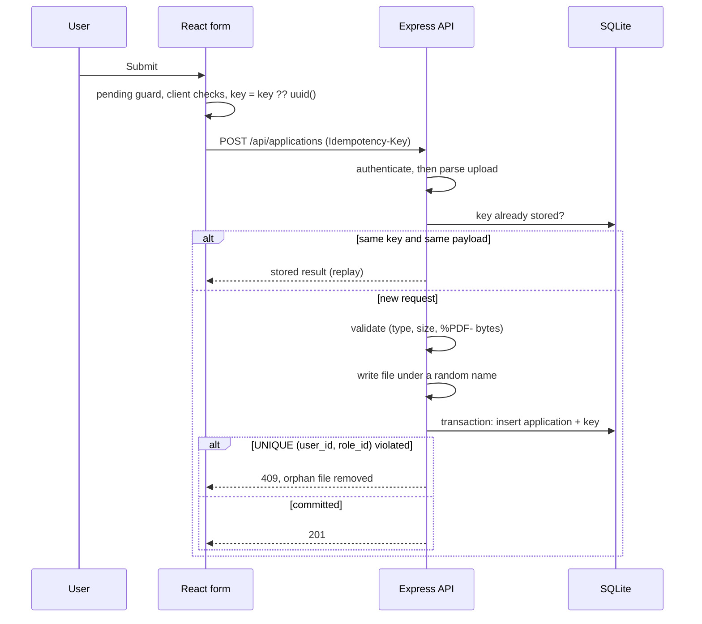

# Accessible Application Form

A small full-stack demo of a job application form with a PDF upload. It was built as a practical work sample, so it focuses on the unglamorous parts of a form: failure paths, retries, session expiry, security and accessibility.

> **All data is fictional.** There are no external services and no real users. The "login" signs you in as a made-up user, `sam.demo`.

- **Frontend:** React (Vite)
- **Backend:** Node.js, Express, `express-session`, `multer`, `helmet`
- **Database:** SQLite (`better-sqlite3`)
- **Tests:** Node's built-in test runner (`node --test`)

---

## Contents

1. [What it does](#what-it-does)
2. [Quick start](#quick-start)
3. [Project structure](#project-structure)
4. [API contract](#api-contract)
5. [How it works](#how-it-works)
6. [Pseudocode](#pseudocode)
7. [Error states](#error-states)
8. [Accessibility](#accessibility)
9. [Security](#security)
10. [Tests](#tests)
11. [Trade-offs](#trade-offs)
12. [Known limitations](#known-limitations)
13. [Tools and AI assistance](#tools-and-ai-assistance)
14. [How I checked the result](#how-i-checked-the-result)

---

## What it does

A signed-in user fills in a name, email, an optional note and a PDF CV, then submits to `POST /api/applications`. The server enforces:

- **Authentication:** a cookie session is required.
- **File validation:** PDF only, up to 2 MB, checked by MIME type and by the file's first bytes (`%PDF-`).
- **One application per user per role:** enforced by a database `UNIQUE (user_id, role_id)` constraint.
- **Idempotency:** retrying the same request never creates a duplicate.

| Requirement | Where it lives |
|---|---|
| Field and form error states | `client/src/App.jsx`, 422 responses from `server/src/app.js` |
| Double-submit prevention | `pendingRef` guard, `aria-disabled` button, client idempotency key |
| Server idempotency | `idempotency_keys` table, replay in the handler |
| One application per user per role | `UNIQUE (user_id, role_id)` on `applications` |
| Expired-session recovery | 401 branch in `onSubmit`, sign-in panel, state kept in memory |
| Secure rendering of untrusted input | React escaping, sanitized filenames, `res.download`, `nosniff` |
| Tests | `server/test/api.test.js` plus the manual checklist below |

---

## Quick start

**Requirements:** Node.js 20 or newer.

```bash
git clone https://github.com/MoazHassain/application-form.git
cd application-form

# Terminal 1: API on http://localhost:3001
cd server
npm install
npm start

# Terminal 2: web app on http://localhost:5173
cd client
npm install
npm run dev
```

Open http://localhost:5173 and click **Sign in**. Both servers must be running; the Vite dev server proxies `/api/*` to port 3001, so the browser sees a single origin and the session cookie works without CORS configuration.

Run the server tests:

```bash
cd server
npm test
```

**Environment variables (optional):**

| Variable | Purpose | Default |
|---|---|---|
| `SESSION_SECRET` | Signs the session cookie | `dev-only-secret` (change for any real use) |
| `NODE_ENV` | `production` turns on `Secure` cookies and removes the dev route | unset |

**Dev helper:** in development, the form shows a **Dev: expire my session** button. It calls `POST /api/dev/expire`, which exists only when `NODE_ENV` is not `production`.

---

## Project structure

```
application-form/
├─ client/
│  ├─ vite.config.js        # proxies /api to the server
│  └─ src/
│     ├─ main.jsx
│     ├─ App.jsx            # form, error states, retry and session logic
│     ├─ api.js             # small fetch wrapper
│     └─ styles.css
└─ server/
   ├─ src/
   │  ├─ app.js             # Express app, DB schema, all routes
   │  └─ index.js           # starts the server on port 3001
   └─ test/
      └─ api.test.js        # automated API tests
```

At runtime the server creates `server/data.db` (SQLite) and `server/uploads/` (stored PDFs). Both are git-ignored.

---

## API contract

| Method and path | Auth | Purpose |
|---|---|---|
| `POST /api/login` | no | Body `{ "username": "sam.demo" }`. Starts a session. |
| `GET /api/me` | yes | Returns the current user, or 401. |
| `POST /api/applications` | yes | Creates an application (`multipart/form-data`). |
| `GET /api/applications/:id/file` | yes, owner only | Downloads the stored PDF. |
| `POST /api/dev/expire` | no | Development only. Destroys the session. |

### `POST /api/applications`

**Headers:** `Idempotency-Key: <uuid>` (required)

**Fields:** `roleId`, `name`, `email`, `note` (optional), `cv` (file)

| Status | Meaning | Body |
|---|---|---|
| 201 | Created (or an idempotent replay, marked with an `Idempotent-Replay: true` header) | `{ id, name, email, note, fileName }` |
| 400 | Missing or oversized idempotency key, or a malformed upload | `{ code }` |
| 401 | Not signed in or session expired | `{ code: "session_expired" }` |
| 409 | Already applied for this role | `{ code: "duplicate" }` |
| 422 | Validation failed, or key reused with a different payload | `{ errors: { field: message } }` or `{ code: "key_reused" }` |
| 500 | Server error (nothing saved, safe to retry with the same key) | `{ code: "server_error" }` |

---

## How it works



### Idempotency versus uniqueness

These solve different problems and are deliberately separate:

- **The idempotency key** makes a retry of the *same request* safe. If the server saved the application but the response was lost to a timeout, the retry carries the same key and receives the original 201 instead of creating a second row.
- **`UNIQUE (user_id, role_id)`** stops a *different* request (a new key, a second tab, a race) from creating a second application for the same role. It is enforced by the database, so it holds even if two requests arrive at once or the app runs as several processes.
- **The payload fingerprint** (a SHA-256 of the fields and file) detects a client reusing a key with different data, which returns 422 instead of silently replaying the wrong result.

Only successful results are stored under a key. A 500 is never cached, so a retry gets a real second attempt.

### Ordering inside the handler

1. Authenticate **before** parsing the upload, so anonymous callers cannot make the server buffer files.
2. Replay a stored result if the key exists.
3. Validate. The server is the authority; client checks are only for user experience.
4. Write the file under a server-generated name. If this throws, no database row exists.
5. Commit the application row and the idempotency row in **one transaction**. If the unique constraint fires, delete the just-written file and return 409.

### Client behaviour

- **Double-submit prevention** has three layers: a `pendingRef` (a ref, because state updates are asynchronous and two fast clicks could both pass a state check), an `aria-disabled` button, and the idempotency key as the final safety net. The button uses `aria-disabled` instead of `disabled` on purpose, because `disabled` drops keyboard focus and disorients screen-reader users.
- **The idempotency key** is created on the first send, reused on every retry of unchanged data, and reset after success or when the user edits any field.
- **Timeouts:** each request has an 8 second `AbortController`. On timeout the user sees a message saying their answers were kept and that sending again will not create a duplicate.
- **Expired session:** a 401 keeps every field, including the selected `File` object, in React state. A panel takes focus and offers **Sign in again**. After sign-in, focus moves to **Send application** and the user resubmits without retyping.

  *Files:* browsers do not let a page restore a file input after a reload. This app keeps the `File` in memory, which covers an expiry while the page stays open. A real app would also store the text fields in `sessionStorage` and ask the user to reattach the PDF after a full reload.

---

## Pseudocode

### Endpoint handler

```
POST /api/applications:
  user = authenticate(request)           or return 401
  key  = header "Idempotency-Key"        or return 400
  file = parseUpload(request)            # max 2 MB, one file

  fingerprint = hash(roleId, name, email, note, hash(file))
  if stored = idempotency[user, key]:
      if stored.fingerprint != fingerprint: return 422 key_reused
      return stored.status, stored.body            # replay

  errors = validate(name, email, note, roleId, file)   # type, size, "%PDF-" bytes
  if errors: return 422 { errors }
  if exists(application where user, role): return 409  # fast path only

  path = save file under random server-generated name  # failure: 500, nothing stored
  transaction:
      insert application(user, role, ...)              # UNIQUE (user_id, role_id)
      insert idempotency(user, key, fingerprint, 201, body)
  on unique violation: delete file, return 409
  return 201 body
```

### Form component

```
state: values, file, errors, formError, pending, needLogin, done
refs:  pendingRef, keyRef

onSubmit(event):
  preventDefault
  if pendingRef: return                                # double-submit guard
  errors = clientChecks(values, file)                  # UX only
  if errors: show summary, focus it, return

  pendingRef = true; announce "Sending"
  keyRef ??= uuid()                                    # same key on retries
  response = POST multipart with Idempotency-Key, 8 s timeout

  201 -> keyRef = null; show confirmation
  401 -> needLogin = true; keep all state; focus sign-in panel
  422 -> map errors to fields and summary
  409 -> keyRef = null; form-level "already applied"
  other or timeout -> form-level message; keep state; same key on retry
  finally pendingRef = false

onEdit(): keyRef = null          # changed data is a new attempt
```

---

## Error states

**Field errors** (shown beside the field and in the summary):

| Field | Error |
|---|---|
| Full name | Missing or longer than 80 characters |
| Email | Not an email address |
| Short note | Longer than 500 characters |
| CV | Missing, over 2 MB, not a PDF, or contents are not a valid PDF |

**Form-level errors** (shown in the summary at the top):

| Situation | Message idea |
|---|---|
| Upload or server failure (5xx) | The upload failed and nothing was saved. Send again. |
| Timeout or lost connection | This is taking too long. Your answers were kept. Sending again will not create a duplicate. |
| Duplicate application (409) | You have already applied for this role. |
| Session expired (401) | Separate sign-in panel, with answers kept |

---

## Accessibility

- Every input has a real `<label>`, and optional or required status is in the label text, not colour.
- Errors are linked to inputs with `aria-describedby`, inputs get `aria-invalid="true"`, and the message text starts with "Error:" so colour is never the only signal.
- On a failed submit, an **error summary** receives focus. Each entry is a link that moves focus to its field.
- A `role="status"` live region announces "Sending your application" and the session messages politely.
- Visible `:focus-visible` outlines, 44 px minimum touch targets, and a logical tab order.
- Correct `type`, `inputMode` and `autoComplete` on name and email, so mobile keyboards and autofill behave.
- The submit button is sticky and respects the iOS safe area, so the on-screen keyboard does not hide it.
- Validation runs on submit rather than on every keystroke, to avoid noisy screen-reader announcements.

---

## Security

| Concern | Measure |
|---|---|
| Untrusted text in the page | React escapes all values; no `innerHTML` or `dangerouslySetInnerHTML` anywhere |
| Malicious filenames | Display names are sanitized and truncated; the stored name is a server-generated UUID, so path tricks like `../../x` are impossible |
| Fake PDFs | The server checks MIME type **and** the `%PDF-` signature; the extension and client MIME type are never trusted |
| Serving files back | `res.download` sets `Content-Disposition: attachment`; `X-Content-Type-Options: nosniff` is set; only the owner can download |
| Anonymous abuse | Authentication runs before the upload is parsed; size and field limits are set on `multer` |
| Sessions | `HttpOnly`, `SameSite=Lax`, `Secure` in production, session regenerated on login |
| Cross-site requests | The custom `Idempotency-Key` header forces a CORS preflight for cross-site callers. A production app should add a proper CSRF token. |
| Headers | `helmet` defaults |

---

## Tests

### Automated (`server/test/api.test.js`)

Each test gets a fresh in-memory SQLite database and a temporary upload folder.

| # | Test | Proves |
|---|---|---|
| 1 | Failed upload | A storage failure returns 500, nothing is saved, and a retry with the **same key** then succeeds |
| 2 | Retry after timeout | Resending the same key replays the original result (same id, `Idempotent-Replay` header); a new key for the same role is blocked with 409 |
| 3 | Expired or missing session | No session returns 401 |
| 4 | Fake PDF | A text file sent as `application/pdf` is rejected on its magic bytes with a field error |
| 5 | Oversize file | A 3 MB file is rejected with 422 |
| 6 | Duplicate application | A second application for the same role with a new key returns 409 |
| 7 | Database constraint | Inserting a duplicate `(user_id, role_id)` directly throws `UNIQUE constraint failed` |

Note on test 2: it verifies the server's replay behaviour. It does not simulate a browser timeout; the 8 second client timeout is covered by the manual checks below.

### Manual: mobile and keyboard behaviour

1. Open DevTools, switch to a 360 px wide device, and reload.
2. **Keyboard only:** press Tab through the page. Focus should move name, email, note, file, send, in visual order, with a visible outline each time.
3. **Enter to submit:** with the name empty, press Enter in a text field. The error summary should receive focus and list the problems.
4. **Summary links:** activate an entry in the summary. Focus should jump to the matching field.
5. **On-screen keyboard:** on a real phone, focus the note field. The **Send application** button should stay reachable and not be hidden behind the keyboard.
6. **Mobile keyboards:** the email field should show the email keyboard and offer autofill.
7. **Double tap:** tap **Send** twice quickly. Only one request should be sent and only one application should exist.

### Manual: client behaviours not covered by automated tests

- **Expired session keeps the draft:** fill in the form, click **Dev: expire my session**, send. The sign-in panel appears with all values still filled in. Sign in, then send. One application is created.
- **Offline or timeout:** set DevTools Network to **Offline**, send, then go back online and send again. The form shows the "taking too long" message, then succeeds without creating a duplicate.

---

## Trade-offs

**Performance**

- No UI framework beyond React and no extra libraries, so the bundle stays small.
- Uploads are held in memory (`multer.memoryStorage`) so the PDF can be validated before it touches disk. That is fine for a 2 MB cap; larger files would need streaming to disk with validation on the first bytes.
- Resumable or chunked uploads would help on poor mobile networks but add server state and complexity that a 2 MB file does not justify.
- Client-side PDF compression is not worth the CPU cost and the risk of corrupting the file.

**Accessibility**

- Submit-time validation is quieter for screen readers than live inline validation, at the cost of slower feedback.
- `aria-disabled` keeps focus where it is but does not stop clicks by itself, so the `pendingRef` guard is required.
- A focus-stealing error summary is a deliberate choice: it is the most reliable way to tell keyboard and screen-reader users that something went wrong, even though it moves focus away from the button.

---

## Known limitations

- **Authentication is a demo.** Anyone can sign in as `sam.demo`. There are no passwords, rate limits or account recovery.
- **A page reload loses the selected file.** Text fields are not yet persisted to `sessionStorage`.
- **No cleanup job** for old idempotency keys (a real system would expire them) or for abandoned uploads.
- **No malware scanning** of uploaded PDFs.
- **No CSRF token** (see [Security](#security)).
- **SQLite is single-node.** The unique constraint is race-proof on one database file. For several app servers, use a networked database such as PostgreSQL with the same constraints.

---

## Tools and AI assistance

I used **Claude (Anthropic's AI assistant)** to help me understand the task, draft the form, the Express API, the SQLite schema, the tests and this README, and to explain the design decisions. I reviewed, ran and edited the result myself. Tools used: Node.js, npm, Vite, VS Code, Git and GitHub.

---

## How I checked the result

*Edit this section so it lists only what you actually did.*

- [ ] Ran `npm test` in `server/` and all tests passed.
- [ ] Ran both servers and submitted the form successfully.
- [ ] Tested an expired session with the dev button and confirmed the draft was kept.
- [ ] Tested offline mode, then resent the form with no duplicate created.
- [ ] Tried a text file renamed to `.pdf` and confirmed it was rejected.
- [ ] Tabbed through the form with the keyboard and checked the error summary focus.
- [ ] Checked a 360 px viewport in DevTools.
- [ ] Ran `npm run lint` in `client/`.
- [ ] Ran an accessibility checker such as axe or Lighthouse.
